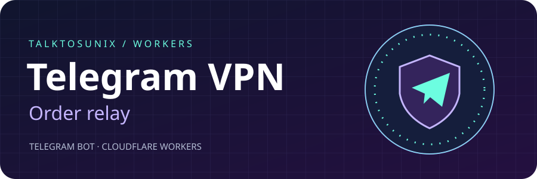
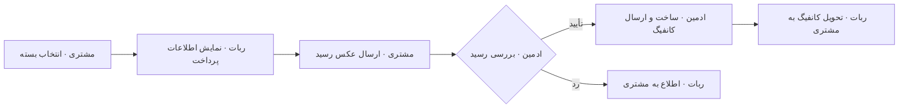

# Telegram Virtual Private Network Sales Bot

**ربات تلگرام برای دریافت سفارش و تحویل دستی اشتراک VPN**

## روند سفارش

1. مشتری عضو کانال می‌شود و یک بسته انتخاب می‌کند.
2. ربات اطلاعات پرداخت را نشان می‌دهد و عکس رسید را برای ادمین‌ها می‌فرستد.
3. ادمین رسید را بررسی می‌کند و تأیید یا رد را به مشتری اطلاع می‌دهد.
4. ادمین با پاسخ به اعلان دارای شناسهٔ مشتری، کانفیگ را برای همان مشتری ارسال می‌کند.

## راه‌اندازی

1. یک ربات تلگرام و یک Worker بسازید. محتوای [worker.mjs](./worker.mjs) را در Worker قرار دهید.
2. توکن ربات را در تنظیمات Worker با نام TELEGRAM_TOKEN به‌صورت Secret اضافه کنید. شناسهٔ عددی ادمین‌ها، کانال و اطلاعات پرداخت را در نسخهٔ خصوصی Worker تنظیم کنید.
3. ربات را به‌عنوان ادمین کانال اضافه کنید و از ادمین‌ها بخواهید یک بار ربات را با /start باز کنند.
4. آدرس HTTPS Worker را با متد setWebhook ثبت کنید و مسیر دریافت رسید و ارسال کانفیگ را با حساب آزمایشی بررسی کنید.

## محدودیت‌های نسخهٔ فعلی

بررسی رسید و ساخت کانفیگ دستی است. کد سفارش‌ها را در پایگاه داده ذخیره نمی‌کند و عکس‌های کاربران عضو کانال را به‌عنوان رسید می‌پذیرد. قبل از استفادهٔ عمومی، اعتبارسنجی secret_token وب‌هوک و ثبت وضعیت سفارش را اضافه کنید.

## مسیر رسید تا تحویل

ربات نقش واسطه را دارد. مشتری با منوی تلگرام سفارش می‌دهد و ادمین از همان گفت‌وگوی تلگرام رسید را بررسی می‌کند. پاسخ ادمین روی اعلان سفارش، به شناسهٔ مشتری در همان اعلان وصل می‌شود.
